<div align="center">

# Prisma

**Convierte una imagen en una página web lista para publicar.**

Aplicación de escritorio para que cualquier persona, sin saber diseño ni programación, cree la
página web de su negocio a partir de su logo, una foto o la captura de una página que le guste.


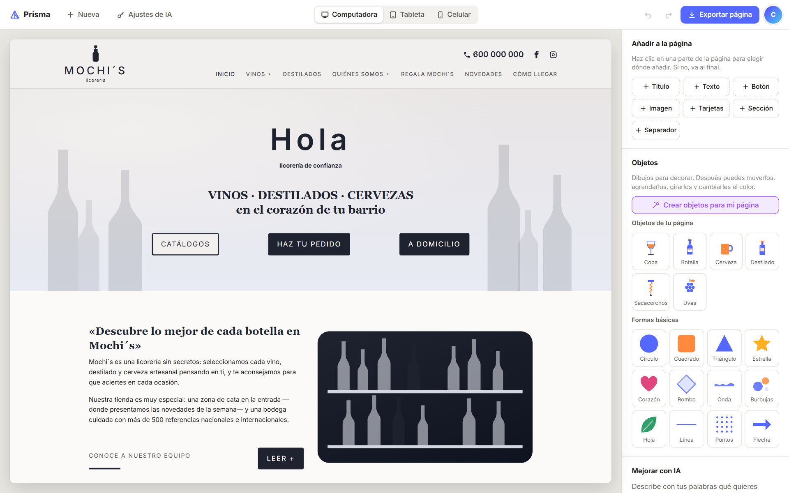

</div>

---

## Contenido

1. [El problema](#el-problema)
2. [Qué hace Prisma](#qué-hace-prisma)
3. [La aplicación funcionando](#la-aplicación-funcionando)
4. [Instalación y uso](#instalación-y-uso)
5. [Diseño de la interfaz](#diseño-de-la-interfaz)
6. [Accesibilidad](#accesibilidad)
7. [Arquitectura y tecnologías](#arquitectura-y-tecnologías)
8. [Seguridad y privacidad](#seguridad-y-privacidad)
9. [Atajos de teclado](#atajos-de-teclado)
10. [Estructura del proyecto](#estructura-del-proyecto)

---

## El problema

Un pequeño negocio (una panadería, una licorería, una peluquería) necesita una página web, pero
las herramientas que hay suelen ser de dos tipos:

- **Constructores profesionales**, con decenas de paneles, capas y términos técnicos («margin»,
  «flexbox», «hex»). Son potentes, pero abruman a quien no es diseñador.
- **Plantillas cerradas**, fáciles de usar pero que no se parecen a la marca del negocio.

Prisma busca el punto medio. **El usuario solo aporta una imagen** que ya tiene (su logo, una foto
del local o la captura de una página que le gusta) y recibe una página completa con sus colores,
que después puede cambiar **haciendo clic directamente sobre ella**.

## Qué hace Prisma

| Función | Descripción |
| --- | --- |
| **Página a partir de una imagen** | Extrae la paleta de colores del logo o la foto y la aplica a una plantilla (negocio, portafolio, restaurante o evento). Funciona sin internet. |
| **Recrear una página con IA** | A partir de la captura de una web o de un boceto hecho a mano, la inteligencia artificial (Claude, de Anthropic) construye una página real y editable. |
| **Edición directa** | Los textos se escriben sobre la propia página, como en un documento. |
| **Mover cualquier cosa** | Botones, títulos, imágenes y dibujos se arrastran a cualquier punto de la página. |
| **Objetos decorativos** | Formas básicas y dibujos creados por IA según el tema de la página (botellas para una licorería, pan para una panadería). Se pueden mover, girar, cambiar de tamaño y de color, y guardar en una colección personal. |
| **Colores que siempre se leen** | El usuario elige qué color va en los botones, en los detalles y en el fondo; Prisma ajusta el resto para cumplir el contraste mínimo de WCAG. |
| **Pedir cambios con palabras** | «Añade una sección de opiniones de clientes» y la IA modifica la página. |
| **Vista en cualquier pantalla** | Computadora, tableta y celular. |
| **Exportar** | Un único archivo `index.html` con todo incluido, listo para publicar gratis en Netlify. |
| **Cuentas** | Cada persona tiene su propia cuenta, y sus páginas y objetos se guardan por separado. |
| **Deshacer y rehacer** | Cualquier cambio, incluidos los movimientos y lo que hace la IA. |

## La aplicación funcionando

> Todas las capturas son de la aplicación real en funcionamiento, con una página de ejemplo para una
> licorería (*Mochi's*) creada con Prisma.

### 1. Inicio de sesión

Pantalla de acceso animada: el prisma descompone la luz en los colores de la marca, las palabras del
lema cambian, la tarjeta tiene un efecto de vidrio y tiembla si los datos son incorrectos. Incluye un
medidor de seguridad de la contraseña y la opción de recordar la sesión.

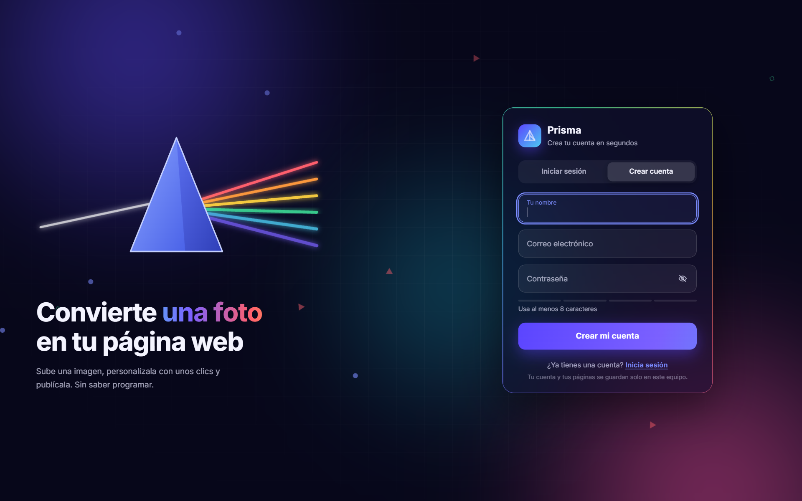

### 2. Subir una imagen

Un solo paso, con una sola acción: arrastrar la imagen o buscarla. Quien no tiene imagen puede
empezar con una plantilla.

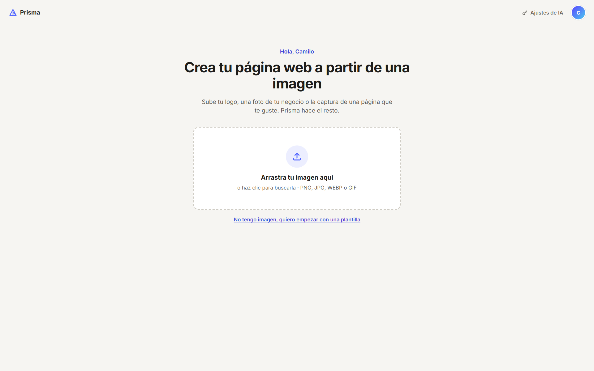

### 3. Elegir qué hacer con la imagen

Prisma muestra al instante los colores que encontró y ofrece dos caminos explicados con un ejemplo
de cuándo conviene cada uno.

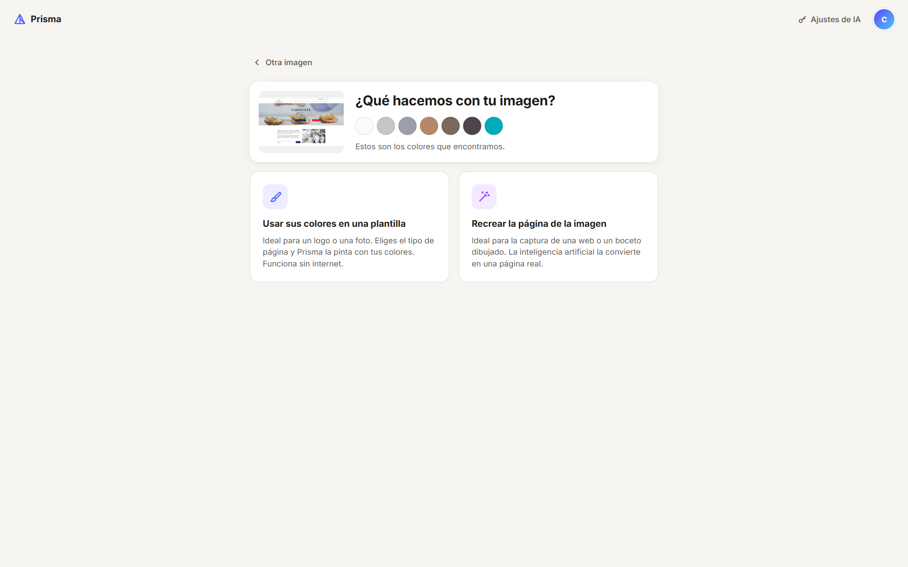

### 4. Elegir el tipo de página

Cada plantilla se muestra en miniatura **ya pintada con los colores de la imagen**, para que el
usuario vea el resultado antes de elegir.

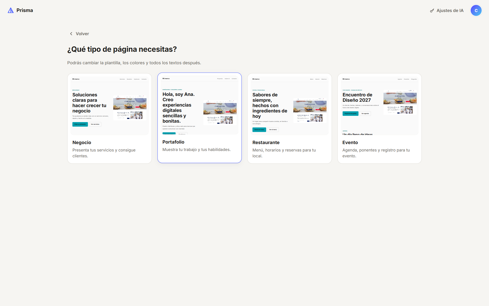

### 5. El editor

La página ocupa casi toda la ventana. A la derecha están las opciones: añadir elementos, objetos,
mejorar con IA, colores, letra y forma.


### 6. Editar un objeto

Al hacer clic en un dibujo aparece un marco con una esquina para cambiar su tamaño, y en el panel
los controles para cambiarle el color, el tamaño y el giro, traerlo al frente o guardarlo en la
colección. Cada pieza de un dibujo (cada botella) se puede seleccionar por separado.

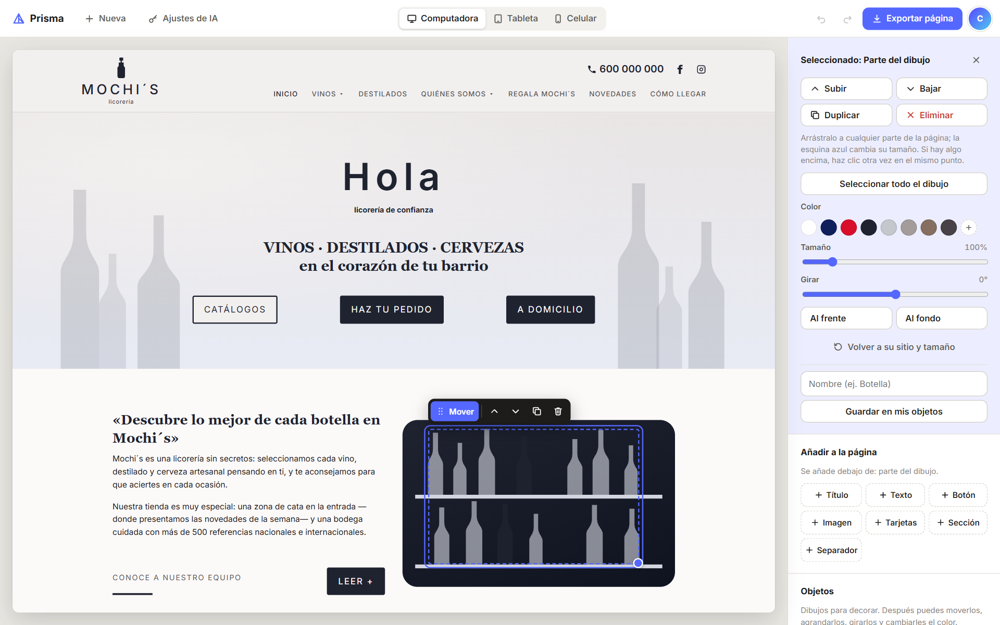

### 7. Barra flotante sobre cualquier elemento

Al seleccionar un botón, un texto o una imagen aparece encima una barra con las acciones más
frecuentes: mover, subir, bajar, duplicar y eliminar. En el panel se puede cambiar adónde lleva el
botón.

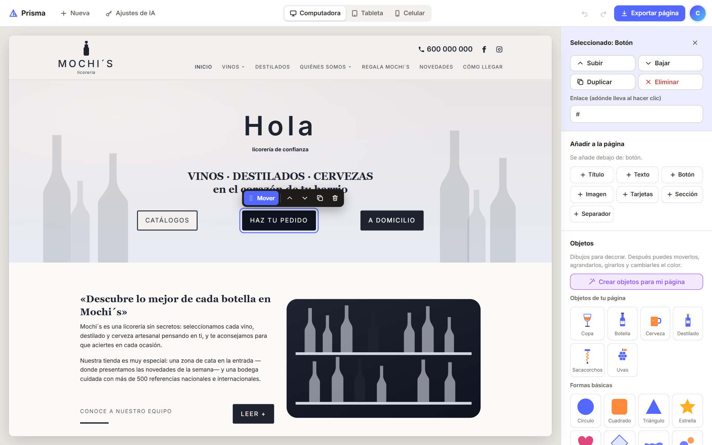

### 8. Moverlo a cualquier parte

Con el asa **Mover** el botón se lleva a cualquier punto de la página, incluso a otra sección.
Prisma conserva su aspecto (colores, letra, tamaño) aunque cambie de sitio.

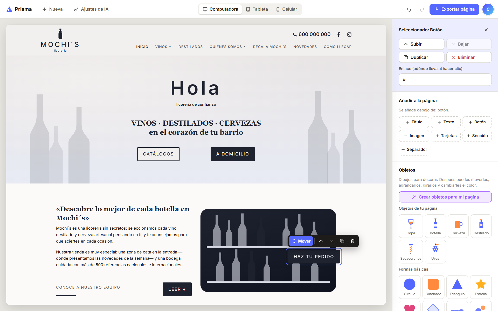

### 9. Colores

El usuario reparte los colores por su función (**Principal**, **Acento** y **Fondo**), con la paleta
de su imagen, colores que combinan, paletas sugeridas, un botón para mezclar y la opción de fondo
oscuro. El indicador verde confirma que todos los textos se leen bien.

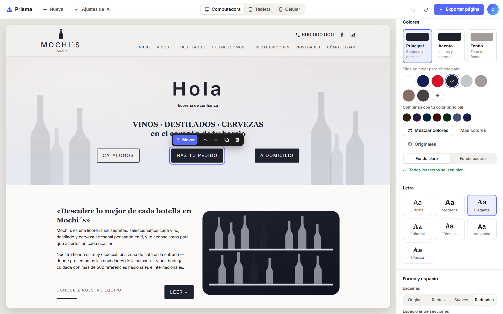

### 10. Vista de celular

La misma página como se ve en un teléfono, para revisarla antes de publicarla.

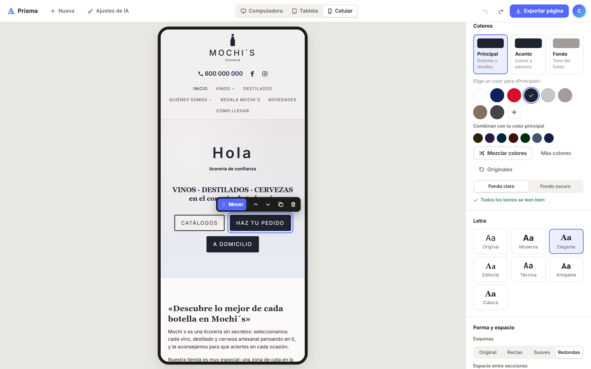

### 11. Mejorar con IA

El usuario describe con sus palabras lo que quiere cambiar o elige una sugerencia. Si hay algo
seleccionado, la IA se centra en eso.

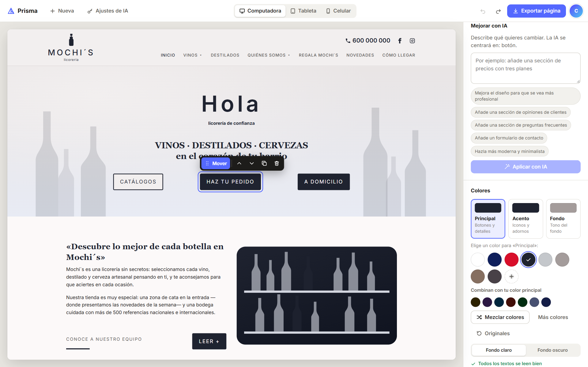

## Instalación y uso

### Requisitos

- Windows 10 u 11
- [Node.js](https://nodejs.org) 22.12 o superior

### Desde el código

```bash
git clone https://github.com/Ju4nK1807/Prisma.git
cd Prisma
npm install      # instala las dependencias
npm run dev      # abre la aplicación en modo desarrollo
```

### Crear el instalador

```bash
npm run build    # comprueba los tipos, compila y crea el instalador
```

El instalador queda en `release/0.1.0/Prisma-0.1.0-Setup.exe`, y la versión sin instalar en
`release/0.1.0/win-unpacked/Prisma.exe`.

> **Windows 11 y el Control Inteligente de Aplicaciones.** Si está activado, Windows bloquea
> Electron y el instalador porque no están firmados digitalmente. Se desactiva en *Seguridad de
> Windows → Control de aplicaciones y navegador → Configuración de Control Inteligente de
> Aplicaciones*.

### Uso paso a paso

1. **Crea tu cuenta.** Se guarda solo en tu equipo.
2. **Sube una imagen** (PNG, JPG, WEBP o GIF).
3. **Elige** usar sus colores en una plantilla o recrear la página de la imagen con IA.
4. **Personaliza:** haz clic en un texto para escribir, arrastra lo que quieras moverlo y usa el
   panel de la derecha para los colores, la letra y los objetos.
5. **Exporta** con el botón *Exportar página* (`Ctrl+E`). Prisma guarda `index.html` en una carpeta
   con el nombre de tu página. Para publicarla, arrastra esa carpeta a
   [Netlify Drop](https://app.netlify.com/drop) y tendrás un enlace para compartir.

Prisma guarda el trabajo automáticamente: al volver a abrirla sigues donde lo dejaste.

### Funciones de IA (opcional)

Recrear páginas, crear objetos y pedir cambios con palabras usan la API de Claude. Se necesita una
clave de [console.anthropic.com](https://console.anthropic.com/settings/keys), que se pega en
**Ajustes de IA**. Ahí también se elige la calidad:

| Calidad | Modelo | Para qué |
| --- | --- | --- |
| Alta | Claude Opus | Los mejores resultados |
| Equilibrada (predeterminada) | Claude Sonnet | Buena calidad a un costo moderado |
| Económica | Claude Haiku | La más barata y rápida |

Sin clave, todo lo demás (plantillas, edición, colores, objetos básicos y exportar) funciona igual y
sin internet.

## Diseño de la interfaz

Prisma se diseñó para personas que **no son diseñadoras**. Esta es la versión rediseñada: la primera
era un generador de sistemas de diseño con tres paneles llenos de controles técnicos, y resultaba
difícil de usar. Estas son las decisiones que guiaron el rediseño.

### Principios

- **Una sola pregunta por pantalla.** El inicio es un camino guiado (imagen → qué hacer → tipo de
  página) en lugar de un formulario largo.
- **La página es la protagonista.** La vista previa ocupa casi toda la ventana y se edita
  directamente: el usuario toca lo que quiere cambiar, en lugar de buscarlo en un formulario.
- **Lenguaje cotidiano.** «Principal», «Acento» y «Fondo» en vez de «primary», «secondary» o códigos
  hexadecimales; «Computadora», «Tableta» y «Celular» en vez de anchos en píxeles; «Esquinas rectas,
  suaves o redondas» en vez de «border-radius».
- **Mostrar en lugar de describir.** Las plantillas, las letras y los colores se eligen viendo una
  muestra, no leyendo un nombre.

### Las 10 heurísticas de usabilidad de Nielsen

| Heurística | Cómo la aplica Prisma |
| --- | --- |
| **1. Visibilidad del estado del sistema** | Los cambios se ven al instante en la página. Mientras trabaja la IA, una pantalla muestra el progreso y permite cancelar. El panel indica qué está seleccionado y avisa si un texto se lee bien. |
| **2. Relación con el mundo real** | Vocabulario sin tecnicismos y botones con iconos reconocibles (papelera, copiar, flechas). |
| **3. Control y libertad del usuario** | Deshacer y rehacer ilimitados, `Esc` para cancelar un arrastre, «Volver a su sitio y tamaño», «Originales» y «Otra imagen» para volver atrás. |
| **4. Consistencia y estándares** | La misma barra flotante para cualquier elemento, los atajos habituales (`Ctrl+Z`, `Supr`) y el mismo comportamiento de selección en toda la página. |
| **5. Prevención de errores** | El contraste se ajusta solo para que ningún texto quede ilegible. Las secciones enteras solo se reordenan entre sí para no romper la página. La clave de IA se comprueba antes de guardarla. |
| **6. Reconocer antes que recordar** | Miniaturas de plantillas con los colores reales, sugerencias de IA listas para pulsar y colección de objetos con su dibujo. |
| **7. Flexibilidad y eficiencia** | Los principiantes usan los botones del panel; los usuarios avanzados, el arrastre directo y los atajos de teclado. |
| **8. Diseño estético y minimalista** | Cada pantalla muestra solo lo necesario; las opciones avanzadas (más colores, paletas) están plegadas hasta que se piden. |
| **9. Ayudar a reconocer y corregir errores** | Mensajes en español y concretos: «La contraseña necesita al menos 8 caracteres», «Ese correo no parece válido», con el campo marcado. |
| **10. Ayuda y documentación** | Pistas breves en el lugar donde se necesitan, por ejemplo: «Arrástralo a cualquier parte de la página; la esquina azul cambia su tamaño». |

### Interacción directa

- **Clic** sobre un texto para escribir; sobre cualquier otra cosa, para seleccionarla.
- **Selección por capas:** si un dibujo tapa un título, el primer clic elige el título y un segundo
  clic en el mismo punto, el dibujo.
- **Arrastre directo** de los objetos; asa **Mover** para botones, textos e imágenes (así, pulsar un
  texto sigue sirviendo para escribir).
- **Esquina azul** para cambiar el tamaño de un objeto.

## Accesibilidad

- **Contraste WCAG 2.1:** Prisma ajusta los colores hasta alcanzar 4.5:1 en los textos, tanto en la
  propia aplicación como en las páginas que crea.
- **Movimiento reducido:** si el sistema operativo lo pide (`prefers-reduced-motion`), las
  animaciones del inicio de sesión se desactivan.
- **Teclado:** todas las acciones principales tienen atajo y los controles se pueden recorrer con
  `Tab`.
- **Lectores de pantalla:** botones de icono con `aria-label`, grupos con `role="radiogroup"`,
  errores anunciados con `role="alert"`.

## Arquitectura y tecnologías

| Tecnología | Uso |
| --- | --- |
| **Electron 44** | Aplicación de escritorio, ventana, menú nativo y diálogos de archivo. |
| **React 19 + TypeScript (estricto)** | Interfaz. |
| **Vite 8** | Desarrollo con recarga instantánea y compilación. |
| **electron-builder** | Instalador para Windows (NSIS). |
| **SDK de Anthropic** | Peticiones a Claude desde el proceso principal. |
| **Inter y JetBrains Mono** | Tipografías incluidas en la app, sin depender de internet. |

### Cómo funciona por dentro

**La paleta sale de la imagen.** Prisma reduce la imagen, agrupa sus píxeles con *k-means* en el
espacio de color **OKLab** (perceptualmente uniforme) y se queda con los colores dominantes. Si la
imagen es casi gris, como un logo en blanco y negro, añade colores derivados de su tono.

**Los colores siempre se leen bien.** El usuario elige qué color cumple cada papel, y Prisma calcula
el resto (fondos, bordes, textos secundarios) en **OKLCH**, subiendo o bajando la luminosidad hasta
cumplir el contraste mínimo. Por eso «Mezclar colores» nunca produce una página ilegible.

**Todo depende de variables CSS.** Las plantillas y las páginas creadas por IA usan las mismas
variables (`--color-primario`, `--fuente-titulos`, `--radio`…). Cambiar una opción solo reescribe
esas variables, así que el cambio se ve al instante, sin recargar la página ni perder lo escrito.

**Edición sobre la página real.** La vista previa es un `iframe`. Los textos editables son
`contenteditable` y cada elemento lleva un identificador interno, que se elimina al exportar.
Mover, duplicar o eliminar son funciones puras sobre el HTML (entra HTML, sale HTML), así que todas
se pueden deshacer.

**Posición libre.** Al soltar un elemento en otro punto, pasa a una capa que cubre toda la página.
Antes de moverlo, Prisma compara cómo se ve dentro y fuera de su sitio y conserva solo los estilos
que perdería: el elemento mantiene su aspecto, y lo demás sigue respondiendo a los colores del tema.

**Objetos creados por IA.** Prisma envía a Claude los textos de la página y le pide dibujos SVG
relacionados con su tema. Los dibujos usan las variables de color de la página, así que cambian de
color junto con ella.

**Historial.** Cada cambio guarda una instantánea del proyecto. Los cambios seguidos del mismo tipo
(escribir, arrastrar un control) se agrupan para que deshacer no vaya letra por letra.

## Seguridad y privacidad

- **Proceso de interfaz aislado:** `contextIsolation` y `sandbox` activados, y el *preload* solo
  expone las funciones necesarias.
- **Clave de IA cifrada** con el almacén seguro del sistema operativo (`safeStorage`). Nunca llega a
  la interfaz: todas las peticiones salen del proceso principal.
- **Contraseñas con hash PBKDF2** (SHA-256, 210 000 iteraciones y sal aleatoria por cuenta). La
  comparación se hace en tiempo constante, y el mismo mensaje de error para correo y contraseña no
  revela qué cuentas existen.
- **Política de seguridad de contenido (CSP)** estricta en la ventana.
- **Páginas limpias:** antes de mostrar una página o un dibujo creados por IA, Prisma elimina
  scripts, `iframe`, manejadores de eventos y enlaces externos. La página exportada es solo HTML y
  CSS.
- **Sin servidor:** las cuentas, páginas y objetos se guardan solo en el equipo del usuario.

## Atajos de teclado

| Atajo | Acción |
| --- | --- |
| `Ctrl+Z` | Deshacer |
| `Ctrl+Shift+Z` / `Ctrl+Y` | Rehacer |
| `Ctrl+E` | Exportar la página |
| `Ctrl+N` | Empezar una página nueva |
| `Alt+↑` / `Alt+↓` | Subir o bajar el elemento seleccionado |
| `Supr` | Eliminar el elemento seleccionado |
| `Esc` | Cancelar un arrastre |

## Estructura del proyecto

```
electron/
  main.ts            ventana, menú, diálogos de archivo y clave de IA cifrada
  ia.ts              peticiones a Claude: generar y modificar páginas, crear objetos
  preload.ts         puente seguro entre la interfaz y el proceso principal
  compartido.ts      contrato de mensajes IPC
src/
  App.tsx            acceso, inicio y editor
  paneles/
    Acceso.tsx       inicio de sesión y registro animados
    Inicio.tsx       subir imagen, elegir camino y plantilla
    Editor.tsx       barra superior, historial y operaciones sobre la página
    Vista.tsx        vista previa editable: selección, barra flotante y arrastre
    Panel.tsx        opciones de diseño, objetos y colores
    DialogoClave.tsx clave y calidad de la IA
    Generando.tsx    progreso de la IA
  estado/            proyecto, historial, cuentas, objetos e IA
  logica/            funciones puras: color, contraste, paleta, tema,
                     plantillas, página, documento e imagen
  controles/         piezas de interfaz reutilizables (iconos, avisos, diálogos)
  estilos/           estilos de la app y del inicio de sesión
docs/capturas/       capturas de este documento
```

---

<div align="center">

Proyecto final de **Diseño de Interfaces de Software** · Desarrollado por
[Ju4nK1807](https://github.com/Ju4nK1807)

</div>
